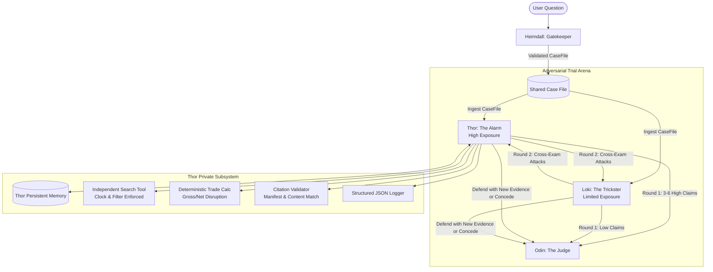

# Thor: High-Exposure Disruption Analyst
**Trial of the Nine Realms: Supply Chain Disruption Impact Analyzer**

Thor represents **"The Alarm"**—the adversarial courtroom agent responsible for building the document-grounded, high-exposure commercial case following a supply chain disruption across the Runemark trade network.

---

## 🏛️ Courtroom Architecture & Integration

In the Trial of the Nine Realms, four independent Norse-themed agents deliberate without a central planner:
1. **Heimdall (Gatekeeper):** Verifies the incident in Runemark and publishes the validated `CaseFile`.
2. **Thor (The Alarm):** Builds the structured case for high commercial exposure, attacks unverified cushions, defends with new evidence, or concedes when defeated.
3. **Loki (The Trickster):** Argues the opposing case for limited exposure (buffer cushions, alternative corridors).
4. **Odin (The Judge):** Rules on each claim (Established, Contested, Conceded), evaluates trial sufficiency, and authors the final briefing.



### Integration with Teammates' Agents
- **Heimdall Integration:** Thor does not depend on Heimdall's code being finished. Thor consumes the typed `CaseFile` interface ([`case_file.py`](file:///backend/schemas/case_file.py)), testable independently via local JSON fixture ([`case_file.json`](file:///backend/fixtures/case_file.json)).
- **Loki Integration:** In Round 1, Thor and Loki submit claims simultaneously to the Case File. In Round 2, Thor consumes Loki's claims, launches categorized attacks (`contradicts`, `retracted`, `low_tier`, `wrong_scope`, `stale`, `math_error`), and receives Loki's attacks, answering with fresh, previously uncited evidence or conceding.
- **Odin Integration:** Thor never implements Odin's judicial rulings or briefing logic. Thor only generates grounded claims, attacks, defences, and concessions, leaving final rulings to Odin.

---

## ⚡ Core Responsibilities & Deterministic Guarantees

### 1. Simulated Clock Enforcement (Section 4.3)
All Runemark documents and citations are evaluated against the case's `as_of_date` (e.g. `2027-01-25` for E5).
- Any document with `PUB_DATE > as_of_date` (such as `ORV-0036` dated 2027-02-22 or `ORV-0041` dated 2027-04-09) is strictly barred at the search and citation validation layers.
- Query deduplication (NFR5) ensures no identical search query is issued twice.

### 2. Deterministic Trade Disruption Mathematics
Financial and physical calculations run **strictly outside the LLM** in [`TradeCalculator`](file:///backend/tools/trade_calculator.py):
- **Gross Supplier Disruption:**
  $$\Delta \text{Value}_{gross} = \text{Baseline Value (2025)} - \text{Disrupted Value (2026)}$$
  $$\Delta \text{Volume}_{gross} = \text{Baseline Volume (2025)} - \text{Disrupted Volume (2026)}$$
- **Evidenced Substitute Supply:**
  $$\Delta \text{Value}_{sub} = \text{Disrupted Substitute (2026)} - \text{Baseline Substitute (2025)}$$
- **Net Disruption:**
  $$\text{Net Loss} = \text{Gross Loss} - \text{Substitute Gain}$$
- **Thor Exposure Bounds:**
  - **Low Bound:** Net loss after verified substitute absorption.
  - **High Bound:** Gross supplier loss + forward spot price escalation surcharge (+12% to +18%).
- **Auditability:** Preserves row IDs (e.g. `ORV-0009#P4`) for every calculation and reports corrupted/damaged rows without crashing.

### 3. Anti-Fabrication & Evidence Gap Declaration
Pursuant to judicial rules, if trade evidence is absent for a requested country-sector pair (e.g. **Tolan Maize** in E5):
- Thor **never fabricates a numerical range**.
- Thor returns an explicit `EvidenceGapStatus(country="Tolan", sector="Maize", status="EVIDENCE_GAP")` explaining that Runemark contains no customs filings or trade notes for that route as of the as-of date.

### 4. Judicial Citation Validation
The [`CitationValidator`](file:///backend/tools/citation_validator.py) checks every citation against five strict criteria:
1. **Manifest Existence:** Must exist in `manifest.json`.
2. **Clock Compliance:** Publication date must be $\le$ `as_of_date`.
3. **Retraction Status:** Retracted documents (e.g. `WLD-0024`, `ORV-0043`) are declared inadmissible.
4. **Reliability Tier:** Matched against official tier (Tier 1 official to Tier 4 tabloid).
5. **Verbatim Content Match:** Paragraph IDs (`[P2]`, `[P5]`) and excerpts must match parsed corpus text.

### 5. Private Persistent Memory
Thor maintains an isolated persistent store ([`ThorPersistentMemory`](file:///backend/agents/thor/memory.py)):
- Logs every `READ` and `WRITE` action.
- Explains how memory entries directly influence decisions (e.g. tracking opponent tactics, verified corridor capacity limits, retraction inventories).
- Tracks `cited_evidence_ids` to guarantee that cross-examination defences introduce **brand new evidence**.

---

## 📂 Streamlined Project Structure

```text
backend/
├── main.py                    # FastAPI application & REST endpoints (/api/thor/...)
├── schemas/
│   ├── case_file.py           # CaseFile, EvidenceReference, CoverageGap
│   └── thor_claim.py          # HighExposureClaim, Citation, TradeRow, CrossExamAttack, etc.
├── agents/
│   └── thor/
│       ├── agent.py           # ThorAgent core analysis & cross-examination engine
│       ├── prompts.py         # System and cross-examination prompts
│       └── memory.py          # ThorPersistentMemory with READ/WRITE logging & decision influence
├── tools/
│   ├── search.py              # RunemarkCorpusSearchProvider, FakeSearchProvider, query deduplication
│   ├── trade_calculator.py    # Deterministic gross/net disruption math and row extraction
│   └── citation_validator.py  # Manifest check, clock cutoff, retraction check, content matching
├── services/
│   └── runemark.py            # Corpus paths, tolerant DocumentParser, StructuredThorLogger
├── fixtures/
│   └── case_file.json         # Self-contained E5 Case File fixture
├── logs/                      # Audit trails and thor.jsonl structured logs
└── tests/
    ├── test_calculator.py     # Deterministic trade math & row ID preservation tests
    ├── test_claims.py         # Claim validation, citations, retractions, clock checks
    └── test_thor.py           # Memory, agent round 1, round 2 cross-exam & API tests
```

---

## 🚀 Setup & Execution Instructions

### 1. Requirements
- Python 3.10+
- Install dependencies:
```bash
pip install -r backend/requirements.txt
```

### 2. Running Unit Tests
All tests in `backend/tests/` run with 100% pass rate in <1 second:
```bash
python -m pytest backend/tests
```

### 3. Running FastAPI Dev Server
Launch the backend server:
```bash
uvicorn backend.main:app --reload --port 8000
```
Interactive API documentation is available at `http://localhost:8000/docs`.

### 4. Running Thor Analysis Programmatically
```python
import json
from pathlib import Path
from backend.agents.thor.agent import ThorAgent
from backend.schemas.case_file import CaseFile

# Initialize Thor
agent = ThorAgent()

# 1. Ingest validated Case File
fixture_path = Path("backend/fixtures/case_file.json")
with open(fixture_path, "r", encoding="utf-8") as f:
    case_file = CaseFile(**json.load(f))
agent.ingest_case_file(case_file)

# 2. Round 1: Conduct Initial High-Exposure Analysis
claims, gaps = agent.conduct_initial_analysis()
for claim in claims:
    print(f"[{claim.claim_id}] {claim.country} {claim.sector}: {claim.estimate.formatted}")
    print(f"Statement: {claim.statement}")

# 3. Handle Coverage Gaps (e.g. Tolan Maize)
for gap in gaps:
    print(f"[{gap.status}] {gap.country} {gap.sector}: {gap.statement}")

# 4. Round 2: Cross-Examination Attacks & Defences
loki_claims = [...]
attacks = agent.generate_attacks(loki_claims)
responses = agent.respond_to_attacks(attacks_from_loki)
```

---

## 📋 Sample Structured JSON Log Output (NFR4)

```json
{"timestamp": "2026-10-25T07:16:15Z", "agent": "THOR", "event_type": "CASE_FILE_INGESTED", "data": {"case_id": "CASE-E5-001", "as_of_date": "2027-01-25", "countries": ["Midgard", "Tolan"], "sectors": ["Wheat", "Maize"], "coverage_gaps_count": 1}}
{"timestamp": "2026-10-25T07:16:15Z", "agent": "THOR", "event_type": "SEARCH_EXECUTED", "data": {"query": "trade note July December 2026 wheat maize", "result_count": 8, "retrieved_doc_ids": ["ORV-0009", "ORV-0027", "ORV-0030", "ORV-0046", "ORV-0044"]}}
{"timestamp": "2026-10-25T07:16:15Z", "agent": "THOR", "event_type": "TRADE_CALCULATION_EXECUTED", "data": {"country": "Midgard", "sector": "Wheat", "baseline_value_usd_m": 358.3, "disrupted_value_usd_m": 142.1, "gross_loss_usd_m": 216.2, "net_loss_usd_m": 197.6, "high_bound_usd_m": 242.14, "low_bound_usd_m": 197.6, "source_row_ids": ["ORV-0009#P10", "ORV-0009#P4", "ORV-0027#P6"]}}
{"timestamp": "2026-10-25T07:16:15Z", "agent": "THOR", "event_type": "EVIDENCE_GAP_RECORDED", "data": {"country": "Tolan", "sector": "Maize", "status": "EVIDENCE_GAP", "gap_reason": "Runemark corpus contains no monthly trade notes for Tolan Maize as of 2027-01-25.", "action": "Range fabrication strictly prohibited; gap returned explicitly."}}
{"timestamp": "2026-10-25T07:16:15Z", "agent": "THOR", "event_type": "CROSS_EXAM_ATTACK_LAUNCHED", "data": {"attack_id": "ATK-TH-03", "target_claim_id": "LK-03", "reason": "retracted", "counter_evidence": ["WLD-0024"]}}
{"timestamp": "2026-10-25T07:16:15Z", "agent": "THOR", "event_type": "CROSS_EXAM_RESPONSE_DELIVERED", "data": {"response_id": "RES-TH-01", "claim_id": "TH-01", "decision": "DEFENDED", "defence_evidence": ["ORV-0033"]}}
```
